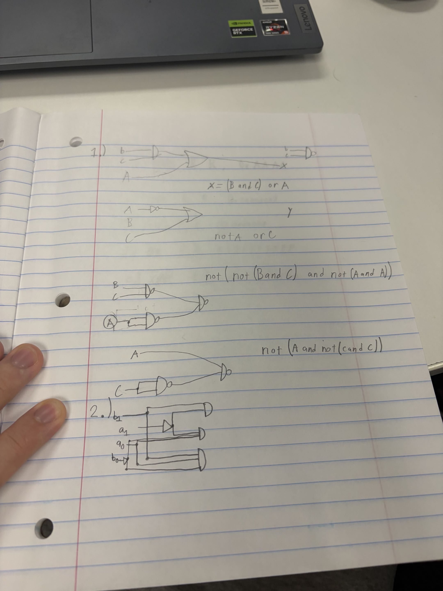
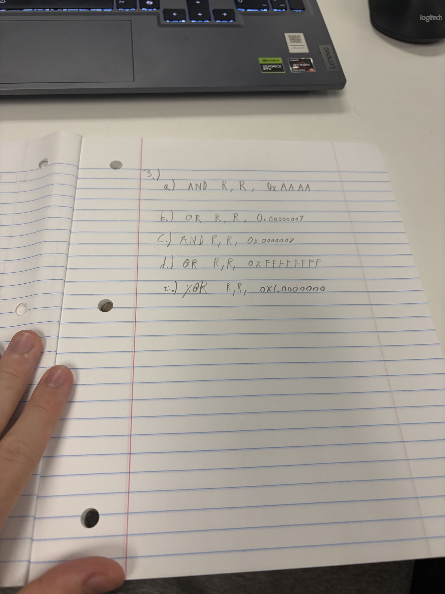

<h1>Homework Assignment #4</h1>

<h2>Authors: Joseph Muhl and Cole Schulein</h2>

<ul>
    
1)   2)

    </img>
    

    
3)

    </img>
    
4) Check <a href="./question4.c">question4.c</a> file in repo

    
5) Check <a href="./question5.txt">question5.txt</a> file in repo

    
6) Check <a href="./question6.txt">question6.txt</a> file in repo

    
7) Check <a href="./question7.txt">question7.txt</a> file in repo

    
8) Check <a href="./question8.txt">question8.txt</a> file in repo

    
9) Check <a href="./question9.txt">question9.txt</a> file in repo

    
10a) The data stored in r8 swaps with the data stored in r9.

    
10b) <code>XOR</code> treats cases when inputs are identical differently from when inputs are opposite. This means that cases where r8 and r9 are the same, the <code>XOR</code> never flips. However, in the case of opposite inputs, the inputs can flip. The first <code>XOR</code> statement will be guarenteed to be true and cause either the 2nd or 3rd (depending on the placement) <code>XOR</code> to be false, causing the switching.

</ul>
